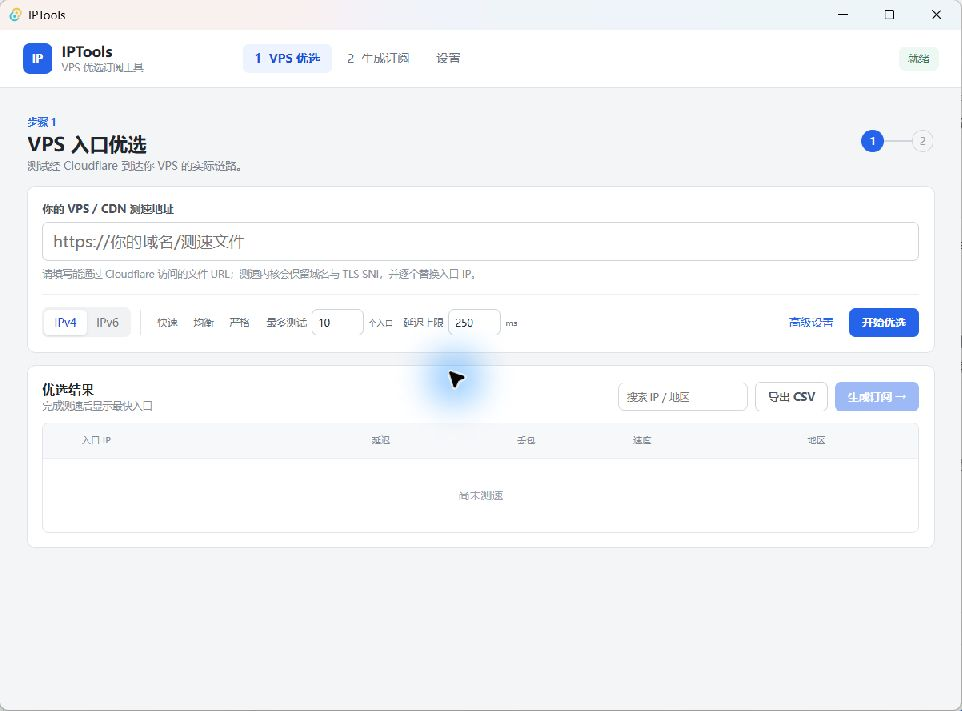
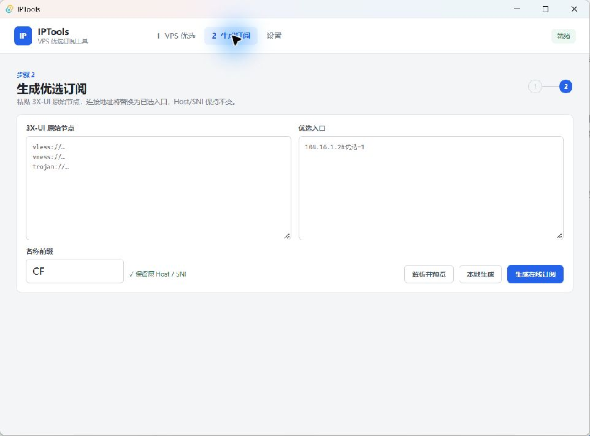
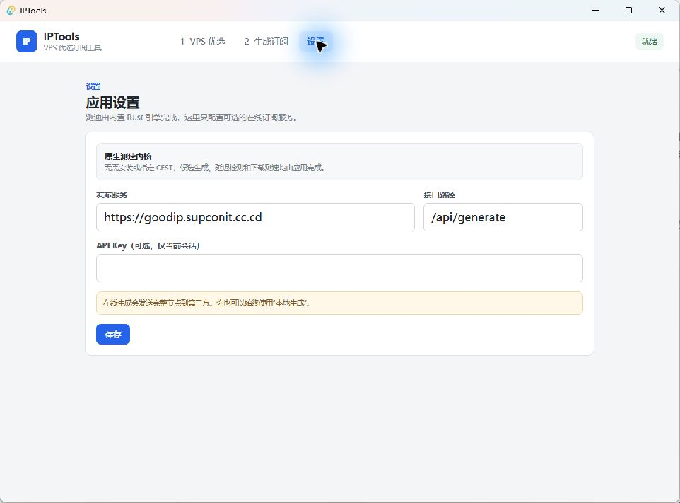

# IPTools 界面体验审计

> 日期：2026-11-18  
> 范围：Windows 桌面端 0.1.0，960 × 680 默认窗口  
> 方法：实际启动 release 程序并捕获三个主要页面

## 总体结论

0.1.0 已统一色彩：暖灰画布、白色面板、深石墨正文、石墨黑主按钮，低饱和靛蓝只用于当前导航、步骤和键盘焦点。主流程及全部导航术语统一为“Cloudflare IP 优选 → 生成订阅”，默认测速不再要求填写 VPS URL 或下载地址；自定义地址收纳在高级设置。通知改为顶部居中的紧凑悬浮胶囊，不遮挡结果表；步骤头部改为单行，输入框、下拉框和按钮统一使用 mini 尺寸；测速运行状态为浅色横向进度条，不再模拟黑色终端；名称前缀使用空值 placeholder，Host/SNI 使用真实 checkbox；在线结果按自动识别、V2rayN、Clash/Mihomo、Shadowrocket 和 Surge 分卡片展示，并增加第三方发送风险确认及脱敏节点预览。订阅生成页增加折叠历史与带确认的清空入口。此前已在 960 × 680 Windows WebView2 调试窗口检查主页面、历史状态筛选、订阅页和设置页；本轮 mini 密度修改已重新构建，仍需在用户机器的相同窗口尺寸做最终视觉复核。当前主要风险是真实面板的长客户端/节点名称和大量结果状态尚未完成视觉验证。

## 步骤 1：Cloudflare IP 优选

**健康度：良好，有可用性修正。**

- 优点：唯一主按钮明确；普通流程无需填写测速地址；IPv4/IPv6、预设和关键参数集中在同一行；空结果状态清楚。
- 风险：参数行信息密度较高，窗口进一步缩小时可能拥挤；mini 尺寸下需要继续验证高 DPI 和触控命中区域。
- 已修正：提高辅助文字颜色与字号、表格字号、按钮最小高度并增加键盘焦点轮廓。
- 已修正：实际测速进度采用浅色横向阶段条，显示延迟、下载、完成和当前处理数量；下载失败原因显示在同一行摘要中。
- 待验证：错误、100 行以上结果和水平缩放状态。

## 步骤 2：生成优选订阅

**健康度：良好，功能状态仍不完整。**

- 优点：左右输入区与“原节点 → 优选入口”的心智模型一致；本地生成和在线生成有清晰的主次关系；保留 Host/SNI 的安全默认可见。
- 已修正：输入为空时禁用生成按钮；在线发布按钮显示解析后的节点数量；本地结果可切换、复制和导出 Mihomo、Surge、Base64 与节点链接，并显示格式兼容提示。
- 待验证：二维码、超长订阅和大量格式告警的视觉状态。

## 步骤 3：应用设置

**健康度：良好，外部服务真实合约仍需验证。**

- 优点：原生测速内核状态明确；在线第三方风险提示可见；API Key 的“仅当前会话”说明直接。
- 已修正：第三方发布总开关、HTTPS 连接测试、3X-UI API Token 会话使用和 Windows 凭据管理器显式保存均已实现。
- 已复核：3X-UI“账号登录 / API Token”切换、用户名/密码/2FA 三列输入及“保存并自动登录”选项在 960 × 680 窗口内保持紧凑；设置说明和在线发布字段已压缩为短标签。
- 风险：API Key 输入框没有显示/隐藏控制；第三方服务的真实响应合约仍需使用虚构节点验证。

## 无障碍证据与限制

- UI Automation 能识别导航、按钮、文本框、数字输入和标题，基础语义树可用；
- 截图不能证明完整键盘顺序、屏幕阅读器播报、200% 缩放和高对比度模式符合要求；
- 已增加明显的 `:focus-visible` 焦点轮廓，但仍需真实键盘走查；
- 颜色没有作为唯一状态信号，但加载、成功、失败状态需要在真实任务中继续验证。
